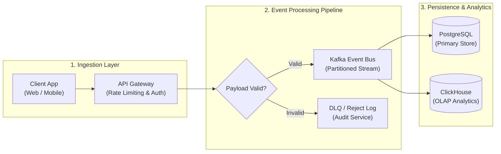
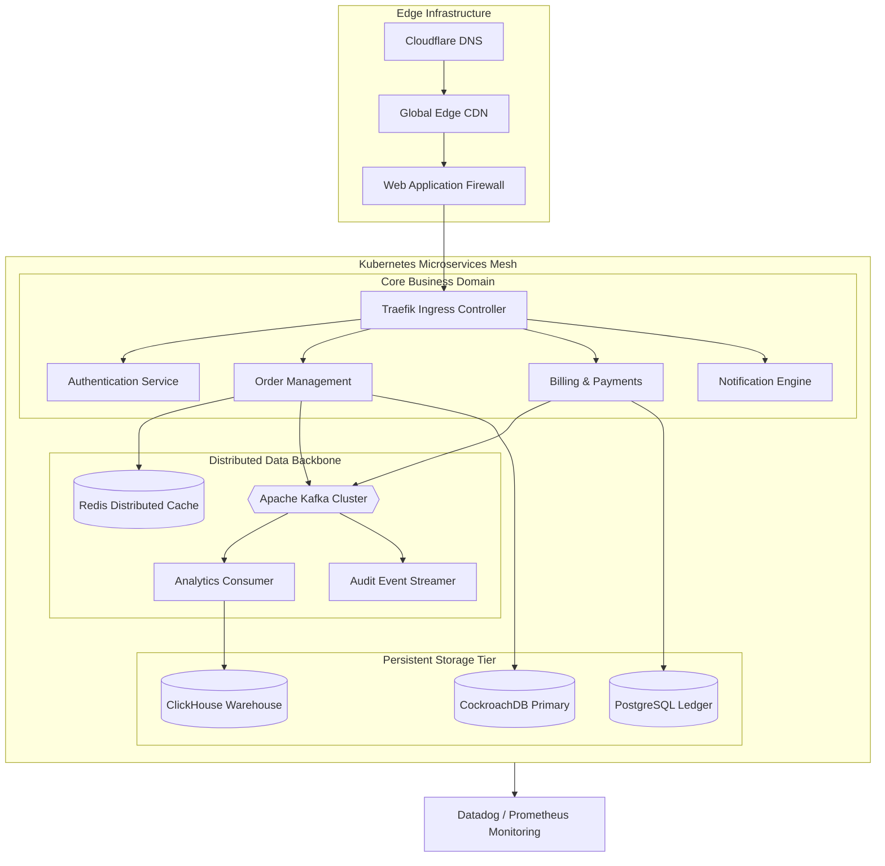
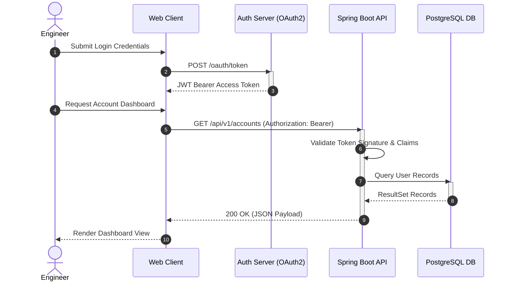
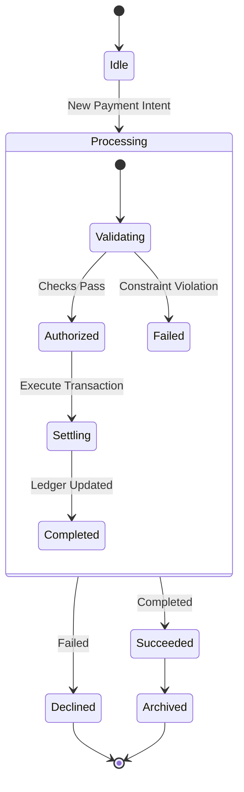
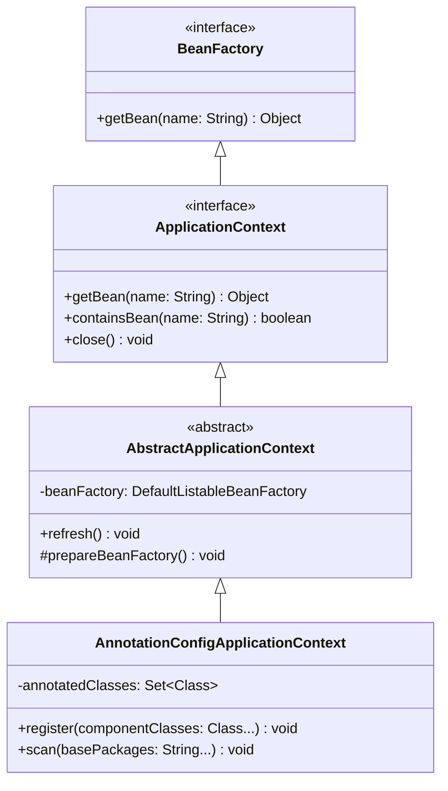
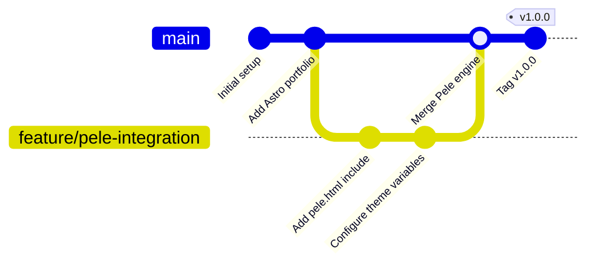
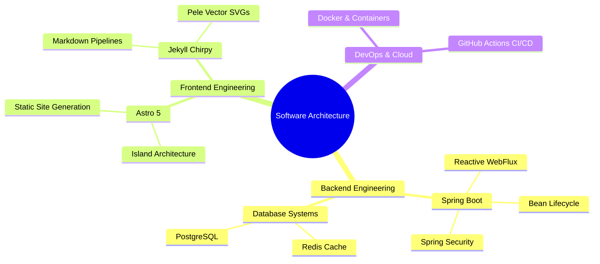
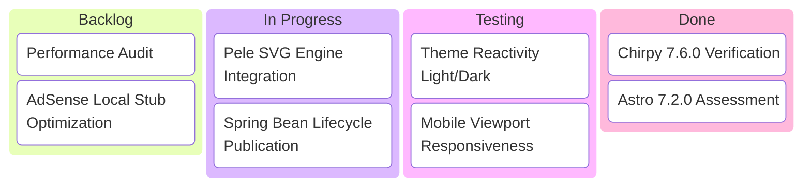
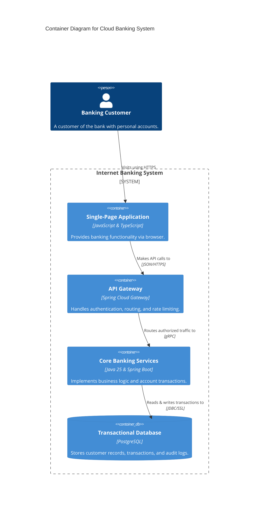

> **Important note:** This is a local demo showcasing how **Pele** renders Mermaid diagrams as lightweight, theme-reactive SVGs in Jekyll Chirpy. It serves as an architectural and visual reference for future technical publications.

---

## 1. Flowchart with Subgraphs and Decision Nodes

Flowcharts in Pele support directional layouts (`LR`, `TD`), nested subgraphs, diamond decisions, and edge labels.

---

## 2. Interactive Zoom and Pan (Large Diagram)

When a diagram is dense or scaled down to fit the container width, Pele automatically mounts interactive **Zoom In (+)**, **Zoom Out (-)**, and **Reset** controls in the top-right corner. You can also drag to pan or use the mouse wheel.

---

## 3. Sequence Diagram

Sequence diagrams feature lifelines, synchronous/asynchronous calls, activations, and note boxes.

---

## 4. State Diagram (`stateDiagram-v2`)

State diagrams model lifecycles, composite states, transitions, and fork/join behaviors.

---

## 5. Class Diagram

Class diagrams allow documenting interfaces, abstract classes, field visibility, and relationships (inheritance, association, composition).

---

## 6. Git Graph

Pele renders Git branching workflows cleanly with commits, tags, and merges.

---

## 7. Mindmap

Mindmaps provide radial or hierarchical exploration of concepts and topics.

---

## 8. Kanban Board

Kanban boards visualize tasks through workflows with custom priorities and tags.

---

## 9. C4 Architecture Container Diagram

C4 diagrams illustrate software systems at container and component boundaries.

---

## 10. Theming & Dark/Light Mode Adaptability

Toggle the theme button (sun/moon) on the top navbar. You will observe:

1. **Instant Color Transitions (0 ms):** SVG colors, background surfaces, connector lines, and text adapt immediately via CSS variables without reloading or re-running scripts.
2. **Semantic Highlights:** Accents, borders, and error states harmonize with Chirpy's `--card-bg`, `--text-color`, and `--main-border-color`.
